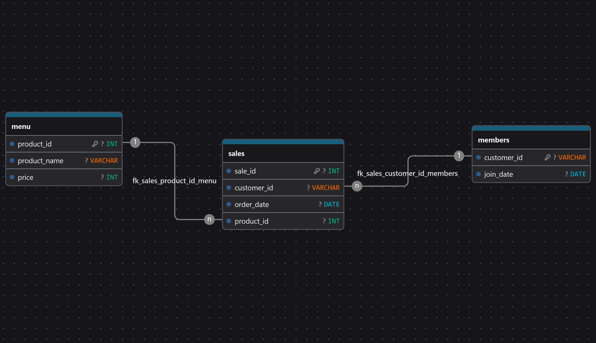

# 🍜 Case Study #1: Danny's Diner

### Part of the [8-Week SQL Challenge](https://8weeksqlchallenge.com/case-study-1/) by Danny Ma · Solved end-to-end in **MySQL 8.0**
### A restaurant customer-behaviour analysis using advanced SQL — CTEs, window functions, and conditional aggregation

[⬅️ Back to Challenge Overview](../README.md)

---

## 🎯 The Business Problem

Danny, the owner of a Japanese restaurant, wants to launch a customer loyalty program but has no data-driven understanding of his customers' behaviour. He asked for answers to 10 business questions covering:

1. **Customer spending** — how much each customer has spent
2. **Visit frequency** — how many days each customer has visited
3. **Menu popularity** — the most-purchased item overall and per customer
4. **Loyalty-program analysis** — what customers ordered before vs after joining
5. **Monetary metrics** — total items and spend before membership
6. **Reward system design** — loyalty points with sushi multiplier + first-week bonus

The output is a set of production-grade SQL queries that demonstrate the techniques used by senior data analysts in real consulting engagements.

---

## 🗄️ Entity-Relationship Diagram

> **Design note:** `sales.customer_id` is **intentionally not** a strict Foreign Key to `members` because Customer C makes purchases but never joins the loyalty program. Every query uses `LEFT JOIN` or conditional logic to preserve Customer C's transaction history — a pattern that mirrors real-world transactional databases where the behavioural table is wider than the program-membership table.

---

## 📊 The Dataset

| Table | Rows | Key Columns | Purpose |
|---|---:|---|---|
| `menu` | 3 | `product_id`, `product_name`, `price` | Product catalog (sushi $10, curry $15, ramen $12) |
| `members` | 2 | `customer_id`, `join_date` | Loyalty program members (A joined 2021-01-07, B joined 2021-01-09) |
| `sales` | 15 | `sale_id`, `customer_id`, `order_date`, `product_id` | Transaction log with a surrogate PK |

**Date window:** 2021-01-01 → 2021-01-16 (16 days)
**Customers:** A (6 orders, member), B (6 orders, member), C (3 orders, non-member)

---

## ⚙️ SQL Concepts Demonstrated

| Technique | Where Used | Why It Matters |
|---|---|---|
| `DENSE_RANK() OVER(PARTITION BY … ORDER BY …)` | Q3, Q5, Q6, Q7 | Handles ties correctly (Customer A's Jan 11 ramen, Customer B's 3-way tie) |
| `CTEs (WITH … AS)` | Q3–Q7, bonus | Readable, auditable pipeline-style logic |
| `DATE_ADD(join_date, INTERVAL 6 DAY)` | Q10 | Models "first week including join date" correctly |
| `COUNT(DISTINCT order_date)` | Q2 | Correctly counts visit days, not order rows |
| `SUM(CASE WHEN … THEN … ELSE … END)` | Q9, Q10 | Conditional aggregation for tiered point rules |
| `LEFT JOIN` + `IS NULL` | Q8, bonus | Keeps non-members in result sets |
| `RANK() OVER()` + `CASE WHEN member IS NULL` | bonus | Only ranks purchases made *after* joining |

---

## ❓ The 10 Business Questions & Solution Summaries

Each query and dashboard-ready audit table lives in [`02_business_solutions.sql`](./02_business_solutions.sql).

---
